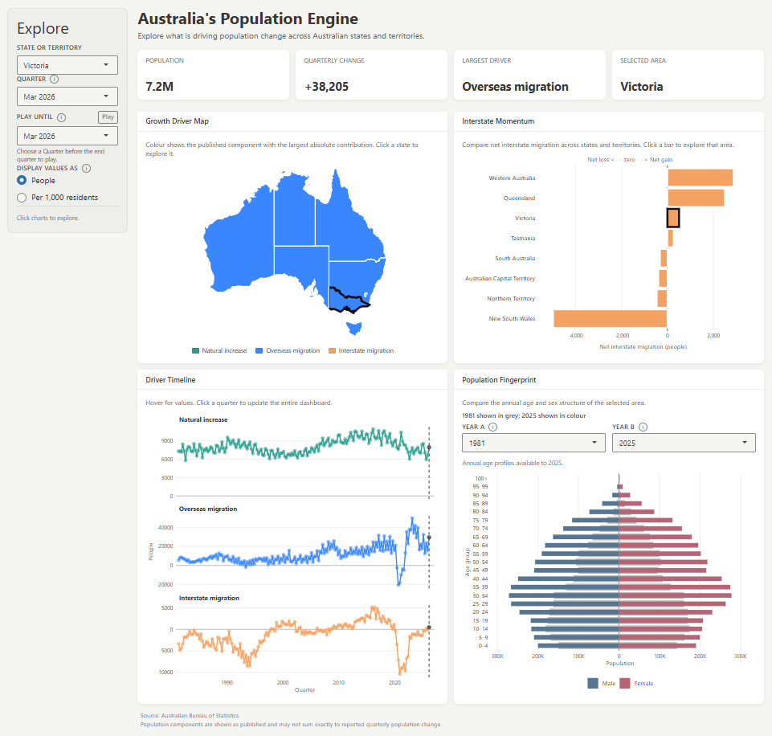

# Australia's Population Engine | Interactive R Shiny Dashboard

An interactive demographic visualisation dashboard exploring **what drives population change across Australia's states and territories**. Built using R Shiny and Australian Bureau of Statistics (ABS) data, the application combines geographic, temporal, migration, and age-structure visualisations into a coordinated analytical interface.

The dashboard examines three components of population change — **natural increase, net overseas migration, and net interstate migration** — alongside population estimates and age-sex distributions. Users can explore historical trends, compare states, switch between absolute counts and population-adjusted rates, and animate population changes across quarters.

Developed as an individual project for **GEOM90007 (Information Visualisation)**, Master of Computer Science, University of Melbourne.

## Dashboard Preview



| Component | Function |
|---|---|
| **Growth Driver Map** | Colours each state or territory by its largest population-change component in absolute terms. |
| **Interstate Momentum** | Compares net interstate migration gains and losses across Australian states and territories. |
| **Driver Timeline** | Displays historical trends in natural increase, overseas migration, and interstate migration. |
| **Population Fingerprint** | Compares age-sex population structures between two selected years using population pyramids. |
| **KPI Cards** | Display population, quarterly change, largest growth driver, and selected geographic area. |

Selecting a state on the map or interstate migration chart updates the relevant dashboard components. Users can also select quarters directly from the timeline.

## Key Features

- **Coordinated interactivity** — chart selections and sidebar controls share reactive state, allowing users to explore different aspects of population change without switching pages.
- **Quarterly animation** — Play/Pause controls advance the selected quarter to a user-defined endpoint, updating the dashboard over time.
- **Population-adjusted comparisons** — switch between absolute counts and rates per 1,000 residents to compare differently sized populations.
- **Interactive geographic analysis** — state-level choropleth map identifies the dominant population-change component for each quarter.
- **Diverging migration chart** — displays positive and negative interstate migration around a common zero baseline.
- **Historical trend exploration** — faceted time-series visualisations show the three growth drivers independently.
- **Population pyramid comparison** — compares two annual age-sex distributions using five-year age bands.
- **Responsive interface** — Bootstrap-based layouts, contextual tooltips, and animated graphical transitions improve usability across screen sizes.

## Technical Implementation

The project follows a three-stage workflow:

**1. Data Auditing**

`01_audit_data.R` inspects the original ABS Excel workbooks, including their observation periods, series structure, missing values, and consistency across state and territory datasets.

**2. Data Preprocessing**

`02_preprocess.R` extracts observations from the ABS spreadsheets, converts them into tidy data structures, and generates three reusable RDS datasets:

- `components.rds` — quarterly population-change components
- `population.rds` — population estimates by state, date, and sex
- `age_profiles.rds` — annual population distributions by age and sex

The preprocessing workflow also performs reconciliation checks, including comparisons between reported population changes and their contributing components.

**3. Interactive Visualisation**

`app.R` loads the processed datasets and implements the dashboard using Shiny's reactive programming model.

The interface combines `ggplot2`, `ggiraph`, `sf`, and `ozmaps`, with custom JavaScript for chart-driven selections and animated quarterly playback.

### Technology Stack

| Technology | Purpose |
|---|---|
| R / Shiny | Application development and reactive logic |
| bslib | Responsive dashboard interface |
| ggplot2 / ggiraph | Interactive charts, tooltips, and selections |
| dplyr / tidyr | Data manipulation and transformation |
| sf / ozmaps | Australian geographic visualisation |
| readxl | Reading ABS Excel datasets |
| JavaScript / CSS | Playback, graphical transitions, and interface customisation |

## Data Source

**Australian Bureau of Statistics (ABS)** — national and state population statistics.

The project uses ABS spreadsheets covering:

- Components of population change
- Estimated resident population
- Population by age and sex across Australia's eight states and territories

Original Excel workbooks and processed datasets are organised in the `Data/` directory.

The age-sex visualisations use annual observations, while population-change analysis uses quarterly observations.

## Repository Structure

```text
Victoria-Demographic-Visualisation/
├── Data/
│   ├── 310102.xlsx
│   ├── 310104.xlsx
│   ├── 3101051.xlsx ... 3101058.xlsx
│   ├── age_profiles.rds
│   ├── components.rds
│   └── population.rds
├── app.R
├── 01_audit_data.R
├── 02_preprocess.R
├── audit_report.txt
├── 1739619_Assignment2_Report.pdf
├── .gitignore
└── README.md
```

## Running the Dashboard

### Prerequisites

Install R and the following packages:

`shiny`, `bslib`, `dplyr`, `ggplot2`, `ggiraph`, `tidyr`, `scales`, `sf`, `ozmaps`, `readxl`, `htmlwidgets`

### Instructions

**1. Clone the repository**

`git clone https://github.com/KarthikKannan1/Victoria-Demographic-Visualisation.git`

**2. Open the project directory**

`cd Victoria-Demographic-Visualisation`

**3. Install dependencies in R (if required)**

`install.packages(c("shiny", "bslib", "dplyr", "ggplot2", "ggiraph", "tidyr", "scales", "sf", "ozmaps", "readxl", "htmlwidgets"))`

**4. Launch the application**

From a terminal with Rscript available:

`Rscript -e "shiny::runApp('.', launch.browser=TRUE)"`

The dashboard will launch locally in your web browser.

The repository includes the processed `.rds` files required by `app.R`, so preprocessing is not necessary for normal use.

### Reproducing the Data Preparation

To regenerate the processed datasets from the source Excel workbooks:

`Rscript 01_audit_data.R`

`Rscript 02_preprocess.R`

Run both commands from the repository root.

## Limitations

- Population-change components may not reconcile exactly with ABS-reported quarterly change.
- Comparisons in absolute counts can be misleading when population sizes differ; population-adjusted rates are provided as an alternative.
- Age-sex distributions are available annually rather than quarterly.
- Historical descriptive relationships do not establish causal explanations for demographic change.

## Academic Context & Usage

This project was developed individually for **GEOM90007 – Information Visualisation**, Semester 2, 2026, at the University of Melbourne.

The repository is shared for portfolio and educational purposes. The underlying ABS data remains subject to its original terms of use.

No open-source licence has been assigned to the project code.

## Author

**Karthik Kannan**

[GitHub Profile](https://github.com/KarthikKannan1)
